# Ball possession from automatic tracking, trained on other matches (team YamineLamal)



<sub>Simulated players, not match data (drawn by <code>scripts/make_banner.py</code>).</sub>

Team **YamineLamal** submission for **More than a Hack 2027, Phase 1: Ball Possession**
(Metrica Sports · FC Barcelona · Mobile World Capital Barcelona).

For every frame of FC Barcelona vs Athletic Club, the pipeline outputs `H`, `A` or `D` with a
three-state hidden Markov model decoded by Viterbi. **Every learned or tuned number comes from
other matches**: Metrica's public sample games, with labels derived from their event data. The
model is trained there, frozen, and applied unchanged to the competition match. It reads the
competition match's automatic tracking, Smart Tagging and broadcast recording **as input only**.
No ground truth, no video and no hand labels of the match are used for anything, and no parameter
is fitted or tuned on the match. See [`docs/TECHNICAL_REPORT.md`](docs/TECHNICAL_REPORT.md).

```
Metrica public sample games ─> train_external.py ─> models/external_params.json  (frozen)
                                                              │
tactical tracking ──────────────────────────────┐             ▼
broadcast tracking ─> align shots ─> fill ball ─┼─> 8 features ─> frozen HMM ─> Viterbi ─> H/A/D
Smart Tagging ──────────────────────────────────┘
```

## Reproduce the submission

**Python 3.12 or newer** (verified on 3.13; the pinned numpy 2.5.3 needs 3.12+).

```bash
pip install -r requirements.txt
```

Unpack the match data into `data/` with the names it ships with ([`data/README.md`](data/README.md)).
Six files are read; no video is needed:

```
data/tactical/BAR-ATH_tactical_atd.xml
data/tactical/BAR-ATH_tactical_atd.txt
data/tactical/BAR-ATH_tactical_smart_tagging.xml
data/broadcast/BAR-ATH_broadcast_atd.xml
data/broadcast/BAR-ATH_broadcast_atd.txt
data/broadcast/BAR-ATH_broadcast_homography.csv
```

```bash
python run.py
python evaluation/validate_submission.py submission/YamineLamal.csv
```

`run.py` takes about 1-2 minutes on a 4-core laptop and writes `submission/YamineLamal.csv` and
`submission/YamineLamal_report.json`, then writes the replay page `submission/viewer.html` and
opens it in the browser (see below). It is deterministic: the same data and command give a
byte-identical file. The frozen parameters it uses are committed in
`models/external_params.json`.

### Watch the output

`python run.py` builds the replay page automatically, after the possession file is written (the
page never changes that file). To rebuild it on its own, or to view a public sample game:

```bash
python scripts/view_match.py              # needs data/ and submission/YamineLamal.csv
python scripts/view_match.py --external 1 # a public Metrica sample game, no match data needed
```

The page is one self-contained HTML file: a 2D replay of the tracking
with players coloured by team, the ball (drawn hollow where it was filled from the broadcast),
the current label, and a full-match timeline of the labels that you can click to seek. The
`--external` view adds a second timeline with that game's event-derived labels. The page embeds
tracking, so it is written to `submission/` (gitignored) and is for local use only. It shows the
output and is not a labelling tool: nothing seen in it goes back into the model, and no ground
truth is read.

### Re-training the frozen parameters (optional)

The parameters can be regenerated from the public external data, byte for byte:

```bash
git clone https://github.com/metrica-sports/sample-data external/metrica-sample-data
python scripts/train_external.py     # ~1 minute; rewrites models/external_params.json
```

It reads no competition data at all. It prints the leave-one-game-out check, training on two
external games and testing on the third.

The submitted file has SHA-256
`6f0b718333586546f61ded5ddd58e2ca8b30307ba9975e69ec12972cb4c88a72`: running `python run.py` on the
official data bundle reproduces exactly this file.

### Options

| flag | effect |
|---|---|
| `--no-broadcast` | skip broadcast fusion (tactical tracking only) |
| `--no-viewer` | do not write the replay page |
| `--no-open` | write the replay page but do not open the browser |

## How it is trained (external data only)

* **Data:** Metrica Sports' three public sample games (https://github.com/metrica-sports/sample-data),
  other professional matches with tracking and event data. Labels are derived from the events
  mechanically (`possession/external.py`).
* **Learned there, then frozen:** the feature bin edges (equal-share quantiles), the emission
  tables, the transition probabilities (mean possession 12.5 s, 24% ending in a stoppage, mean
  stoppage 22.7 s) and the evidence scale (chosen to maximise the organisers' own spellF1 on those
  games).
* **Fixed rules, no data:** each run of identical feature values is one observation, capped at
  one per second. Smart Tagging tables are fixed priors. Set-piece tags are split into quarters.
  A half is dead before its kickoff tag opens.
* **Generalisation:** trained on two external games and tested on the unseen third, spellF1 is
  **0.572 / 0.576 / 0.567** against that game's event-derived labels. Those labels are not the
  competition's ground truth, so this shows transfer between matches rather than predicting the
  competition score.

## Repository layout

```
run.py                        the one command (strict-external model)
possession/
  config.py                   every constant, each tagged with its source
  sources.py                  readers: tactical ATD, metadata, Smart Tagging
  features.py                 per-frame categorical features
  hmm.py                      3-state HMM tables and Viterbi decoding
  strict.py                   the submitted model: train on external games, apply frozen
  external.py                 readers + event-derived labels for the public sample games
  broadcast.py                broadcast-to-tactical alignment and ball fill
  extensions.py               candidate extra features, tested and not adopted (see report)
  pipeline.py                 data in, possession file out
  viewer.py                   self-contained HTML replay of tracking + labels
models/external_params.json   the frozen parameters (trained on external data)
scripts/train_external.py     regenerates models/external_params.json from the public sample games
scripts/test_extensions.py    leave-one-game-out test of candidate extra features (external data)
scripts/view_match.py         writes and opens the replay page (local only)
scripts/make_banner.py        draws docs/assets/pitch.svg, the simulated README banner
tests/                        synthetic-data tests, no match data needed: python -m pytest -q
evaluation/                   the organisers' validator and scorer, unchanged (MIT)
games.py                      the organisers' per-match constants, unchanged (MIT)
docs/TECHNICAL_REPORT.md      the technical document (rendered: docs/YamineLamal.pdf)
data/, external/, submission/ match data, external data, generated output: all gitignored
```

## Rules compliance, in short

* **Training and tuning on external data only.** Every learned or tuned number in the submitted
  model comes from Metrica's public sample games. Nothing is fitted to the competition match.
* **The competition data is used as input only:** tracking, Smart Tagging and broadcast tracking.
  The videos are not used.
* **No ground truth.** No parameter was fitted, calibrated or chosen on the public ground truth,
  and the submitted model was never scored against it.
* **No hand labels or manual data** on the provided game.
* **No match data in this repository.** `data/`, `external/` and `submission/` are gitignored.

## Licence

`evaluation/` and `games.py` are the organisers' files, unchanged, under their MIT licence
(`LICENSE-organisers`). The rest of the code is the team's own. Neither the match data nor
Metrica's sample data is covered by the organisers' licence; the sample data is acknowledged above.
